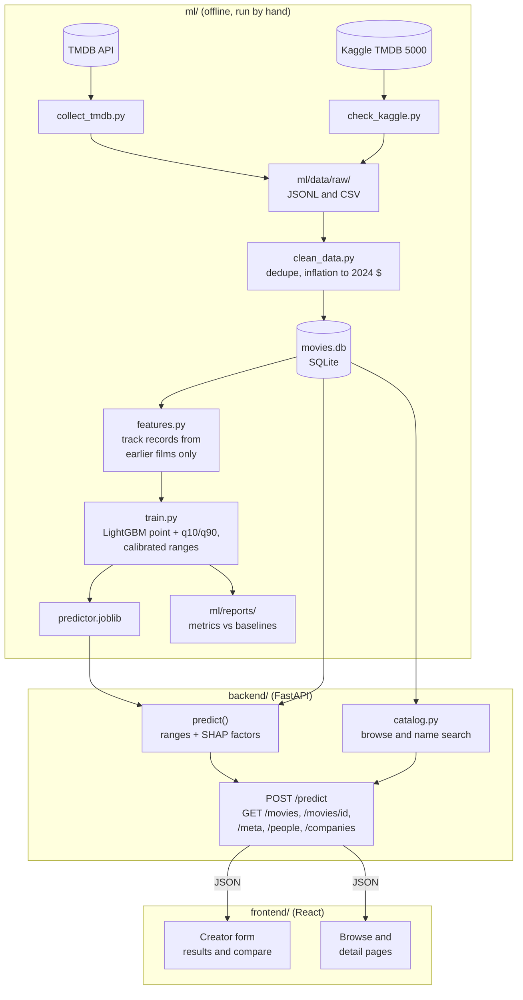

# Movie Prediction App

## Problem statement

Movie creators lack a quick, data-backed way to sanity-check a project before pitching it, and audiences lack one easy place to explore movies.

This app lets **creators** enter a movie's parameters (genres, runtime, release month and year, language, production company, director, top 3 billed actors, optional budget and overview) and get estimated **ranges** for budget, worldwide box office and audience score, each with the top factors behind it in plain English. They can then change one input and see how the prediction moves. The **public** can browse, search and filter movies and open a detail page for each.

A 5-minute demo script is in [docs/demo-script.md](docs/demo-script.md) and a one-page summary in [docs/summary.md](docs/summary.md).

## Stack

- **ML:** Python 3.12, pandas, scikit-learn, LightGBM (quantile models for the ranges, SHAP values from LightGBM for the factors)
- **Backend:** FastAPI, Pydantic, SQLite
- **Frontend:** React 19 with React Router, on Vite, in plain JavaScript and CSS
- **Data:** [TMDB API](https://developer.themoviedb.org/) and the Kaggle TMDB 5000 dataset as a fallback for older films

## Architecture



- **`ml/`** pulls the data, cleans it into SQLite, builds the features, trains and evaluates the models, and saves one bundle with joblib. `ml/src/predict.py` holds the single `predict()` function.
- **`backend/`** imports `predict.py` and `features.py` directly from `ml/src`, so no ML code is copied. At startup it loads the bundle and the movie history once, then serves predictions and the browse data.
- **`frontend/`** is the creator form with its results, and the public browse and detail pages. In development, Vite forwards `/api` to the backend.

**The no-leakage rule.** `popularity`, `vote_count` and `vote_average` exist only after release, so they're never features. The director, actor and company track records use only films released before the target film. `ml/tests/test_leakage.py` and an API test check this, and they fail if the date rule is broken.

## How to run

You need Python 3.12, Node 22 LTS and a free [TMDB API](https://www.themoviedb.org/settings/api) token. The commands below are for Windows from the repo root; on macOS or Linux use `.venv/bin/python`.

**1. Setup.** Copy `.env.example` to `.env` and fill in `TMDB_READ_TOKEN` (or `TMDB_API_KEY`). The Kaggle dataset is public, so its credentials are optional.

```bash
py -3.12 -m venv .venv
.venv/Scripts/python -m pip install -r backend/requirements.txt
```

`backend/requirements.txt` includes `ml/requirements.txt`.

**2. Data.** The database, the raw data and the trained models are git-ignored, so a fresh clone builds them first. The TMDB pull is resumable: rerun it after an interruption and it skips the films it already has. The full pull is about 35,000 films and takes a while.

```bash
.venv/Scripts/python ml/src/collect_tmdb.py
.venv/Scripts/python ml/src/collect_tmdb.py --add-ids --sort revenue.desc --per-year 500
.venv/Scripts/python ml/src/collect_tmdb.py --add-ids --sort vote_count.desc --per-year 500
.venv/Scripts/python ml/src/check_kaggle.py
.venv/Scripts/python ml/src/clean_data.py
```

For a quick try, `collect_tmdb.py --limit 20` pulls 20 films only.

**3. Models.** `baselines.py` and `train.py` write the metrics to `ml/reports/`, and `train.py` also saves `ml/models/predictor.joblib`, the bundle the app uses.

```bash
.venv/Scripts/python ml/src/baselines.py
.venv/Scripts/python ml/src/train.py
.venv/Scripts/python ml/src/predict.py
```

The last command prints a prediction for an example film.

**4. The app.** Start the API, then the frontend in a second terminal, and open http://localhost:5173.

```bash
.venv/Scripts/python -m uvicorn app.main:app --reload --app-dir backend
```

```bash
cd frontend
npm install
npm run dev
```

The interactive API docs are at http://127.0.0.1:8000/docs. The endpoints are listed in [backend/README.md](backend/README.md) and the pages in [frontend/README.md](frontend/README.md).

**5. Checks.** The tests build their own small database and models, so they don't need the real data.

```bash
.venv/Scripts/python -m pytest ml/tests backend/tests -q
```

```bash
cd frontend
npm run lint
npm run build
```

## Evaluation results

**Data.** The database has 35,950 films released 1916–2025, mostly from the TMDB API, plus older films that only the Kaggle dataset has. 10,751 of them report both a budget and revenue of at least $5,000. The models train on the 10,551 of those released from 1980 on; older films only count towards track records. Every film stays in the database for browsing.

**Split.** The split is by release year:
- **Train:** 1980–2015.
- **Valid:** 2016–2018, used only for early stopping and to calibrate the ranges.
- **Test:** 2019 onward, never used for training, tuning or calibration.

Revenue and budget are scored on log(2024 dollars). The columns are:
- **MAE:** mean absolute error.
- **MdAPE:** median absolute % error in dollars.
- **coverage:** the share of films whose true value falls inside the predicted 10–90% range. The target is 80%.
- **width:** the range's median width.

Score is TMDB's 0–10 vote average, for films with at least 50 votes. The full tables, including train, are in `ml/reports/models.csv` and `ml/reports/baselines.csv`.

| target | model | valid MAE | valid R² | test MAE | test R² | test MdAPE | test coverage |
|---|---|---|---|---|---|---|---|
| log-revenue | median per genre (baseline) | 1.662 | 0.044 | 1.954 | −0.121 | 138% | 78% |
| log-revenue | line in log-budget (baseline) | 1.232 | 0.430 | 1.372 | 0.397 | 76% | 77% |
| log-revenue | LightGBM, with budget | 1.042 | 0.569 | 1.240 | 0.483 | 77% | 74% |
| log-revenue | LightGBM, no budget | 1.138 | 0.501 | 1.335 | 0.418 | 81% | 77% |
| score | median per genre (baseline) | 0.583 | 0.073 | 0.617 | −0.062 | – | 77% |
| score | LightGBM | 0.491 | 0.339 | 0.526 | 0.204 | – | 78% |
| log-budget | median per genre (baseline) | 1.312 | −0.068 | 1.408 | −0.098 | 90% | 79% |
| log-budget | LightGBM | 0.652 | 0.700 | 0.702 | 0.715 | 49% | 78% |

- **Budget model.** It estimates the budget from everything except the budget itself: genres, runtime, release date, language, the overview topics, and the director, lead actors and lead company's track records. The strongest inputs are the median budgets of the cast's and director's earlier films; the overview topics add about 8% of the gain.
  - The "rough estimate" rule was fixed before training and is decided on valid only: the model needs a valid R² of at least 0.30 and an MAE at least 15% below the genre median. It reaches 0.700 and 50%, so its ranges are shown without the "rough estimate" label.
- **Budget track records.** Since Day 6 every model also sees the median budget of the director's, actors' and company's earlier films. Compared with Day 5, score improved slightly, revenue with budget is about the same, and revenue without budget is slightly worse on test (MAE 1.310 → 1.335).
- **Matching the creator form (Day 7).** Checking `predict()` on real 2024–25 films showed two inputs that the form can't fill the way the data does, so both were changed in training too:
  - **Number of companies:** this feature was dropped. Listed films name a median of 4 companies, but the form asks for one, which pulled every prediction down (budget by about 14%).
  - **Blank overview:** a blank overview now gets the average topics of training films that have one, instead of the topics of an empty text. Only 4% of training films have no overview, and they're mostly small films.
  - The test numbers barely moved: every model's test MAE changed by less than 0.01. On the 2024–25 films, run through `predict()` with their real inputs, revenue range coverage went from 75% to 79%.
- **Calibration.** Each LightGBM range comes from 10% and 90% quantile models. It's then widened by a single margin, chosen so that 80% of valid films fall inside; this method is conformalized quantile regression. Without calibration, test coverage is 71% for revenue, 70% for score and 73% for budget.
- **Range width.** The calibrated ranges are still narrower than the baselines': a median width of 3.44 vs 3.87 on log-revenue, 1.59 vs 1.87 on score, and 1.94 vs 3.91 on log-budget.
- **Test years.** All models except budget do worse on the test years than on valid, and test coverage is a few points below 80%. The per-year breakdown is in `ml/reports/coverage_by_year.csv`.
  - **Revenue:** most of the gap is the 2020–21 cinema closures. Coverage drops to 65–72% in 2020–21, because about 25–30% of those films earned less than their range. Without 2020–21, coverage is 77% with budget and 79% without.
  - **Budget:** coverage is 76–82% in every test year except 2020 (73%).
  - **Score:** the gap is steady drift. In every test year, 14–19% of films score above their range, where a 10–90% range should leave about 10% above. Recent films score higher than the training years predict.
  - The ranges were not re-tuned on the test years, which would make these numbers dishonest. The app's saved models are instead refit on films up to 2023 and calibrated on 2024–25, where their ranges cover 80% of films. Those 2024–25 numbers are calibration, not a test.
- **What drives the predictions.** Each prediction is explained with SHAP values, computed exactly by LightGBM, which are summed into readable factors. Across the test films the largest factors, by share of mean |SHAP|, are listed below. The full table is in `ml/reports/importance.csv`.
  - **Revenue, with budget:** budget 48%, production company 12%, runtime 10%.
  - **Revenue, no budget:** production company 27%, director 18%, runtime 16%.
  - **Score:** runtime 27%, genres 22%, director 18%.
  - **Budget:** lead actors 29%, director 15%, production company 14%.
  - These show what the models lean on, not cause and effect.

## Limitations

The app shows a short version of these under every prediction.

- **Ranges, not answers.** Each range is a 10–90% range. About 8 in 10 similar past films fell inside it, so about 1 in 5 films lands outside, above or below. On the test years, coverage is a few points below 80% (see above).
- **Which films it learned from.** TMDB films from 1980–2025 that report both a budget and revenue. These are mostly larger and US releases, so small and non-English films are under-represented. Revenue is worldwide box office in 2024 dollars; streaming, TV and home video aren't counted.
- **What it can't see.** Marketing spend, reviews, competing releases, the script's quality, or how a release actually went. The score model in particular explains only about a fifth of the variance on test (R² 0.20).
- **Track records come only from our data.** A director's or actor's earlier films count only if they are in the database, and anyone not in it is treated as a newcomer with no earlier films. Only the top 3 billed actors and one production company are used.
- **Drift.** Recent films score higher than the training years predict, and the 2020–21 cinema closures make box office for those years unusual. The app's models are refit on films up to 2023 and calibrated on 2024–25, but drift after that isn't measured.
- **The factors are associations.** The SHAP factors show what the model leans on, compared with a typical film in the data, not cause and effect.
- **Speed.** A prediction takes about 0.75 s, mostly rebuilding track records against the full history.
- **Not deployed.** Day 14 (deployment) was skipped, so the app runs locally only and the plan's "the app is live" check isn't met.

## Next steps

- **Deploy.** Host the API and the static frontend on a free tier such as Render, Fly.io or Railway. The database and the model bundle are git-ignored, so they need to be built during the deploy or uploaded as files. Set `VITE_API_URL` when building the frontend and `CORS_ORIGINS` on the API, then check the live link end to end.
- **Keep the data fresh.** Schedule the resumable TMDB pull and retrain, so new releases join the track records and the ranges are recalibrated on the latest years.
- **Faster predictions.** Precompute each person's and company's track record by date instead of rebuilding them on every call.
- **Better targets.** Add streaming and home-video revenue where a source exists, and model the score drift over time directly.
- **Compare more.** Let "try changing one thing" swap the director, an actor or the company, which needs the autocomplete in the compare panel.

---

This product uses the TMDB API but is not endorsed or certified by TMDB.
